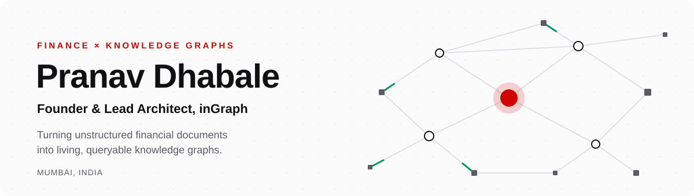

<a href="https://ingraph.space">
  <picture>
    <source media="(prefers-color-scheme: dark)" srcset="assets/banner-dark.svg" />
    <source media="(prefers-color-scheme: light)" srcset="assets/banner-light.svg" />
    
  </picture>
</a>

  
  
  
  

 

## About

I'm a fintech researcher and systems engineer. I build **knowledge graphs**, **graph-augmented retrieval (GraphRAG)** and **high-throughput financial data structures**.

I studied at **Sydenham College of Commerce and Economics** and wrote ***Arth Mitraa***, a guide to institutional banking. My work joins finance knowledge with low-level systems design:

- **From chaos to graphs.** Turning 10-K filings, loan covenants and pitch decks into graphs you can query.
- **Cloud and local, side by side.** One engine that runs as a multi-tenant cloud service and as an air-gapped desktop app.
- **Trust you can check.** Hardware-bound AES-256 vaults and offline Ed25519 licensing.

 

## What I'm building

<table>
  <tr>
    <td width="50%" valign="top">
      <h3><a href="https://ingraph.space">inGraph</a></h3>
      DUAL-ENGINE FINANCIAL INTELLIGENCE
      
A knowledge graph platform, in the cloud and on the desktop, for financial disclosures, holding-company webs and transaction diligence.

      <ul>
        <li><b>Dual-store core.</b> Cloud PostgreSQL with Apache AGE, plus embedded Kùzu and DuckDB on the desktop.</li>
        <li><b>Offline licensing.</b> Ed25519 signatures with an <code>ingraph://</code> deep link.</li>
        <li><b>Hardware locker.</b> AES-256-GCM vault bound to the machine.</li>
      </ul>
      

        <a href="https://ingraph.space">Open the platform</a> ·
        <a href="https://github.com/dpraanav558-glitch/ingraph-releases/releases">Download the desktop preview</a>
      

    </td>
    <td width="50%" valign="top">
      <h3>FinGraph</h3>
      STARTUP AND VENTURE GRAPH
      
Maps shareholder structures, founder–investor ties and private-market syndicates on one visual canvas.

      <ul>
        <li><b>Graph engine.</b> Multi-hop Cypher queries that surface hidden cross-holdings and contagion risk.</li>
        <li><b>Document intake.</b> Docling OCR and layout parsing for pitch decks and cap tables.</li>
        <li><b>Interactive canvas.</b> Live radial and hierarchical layouts.</li>
      </ul>
      
Neo4j · IBM Docling · Gemini 2.5 · React Flow

    </td>
  </tr>
</table>

 

## Stack

> **How I build.** I'm a systems person first and a vibe coder by method. I think in architecture: how the data flows, where it's stored, what has to be trusted and why. Then I build it hand in hand with AI coding tools. I don't write every line from memory. I design the system, make the calls and make sure the pieces fit. The tools below are what my systems run on.

| Area | Tools |
| :--- | :--- |
| **Graphs and data** | Apache AGE · Kùzu · DuckDB · Neo4j · PostgreSQL (Supabase) · Redis |
| **AI and extraction** | Gemini 2.5 · LangChain · IBM Docling · pdfplumber · GraphRAG · Pydantic |
| **Languages** | Python 3.11+ · TypeScript · Rust (Tauri v2) · SQL · openCypher |
| **Frontend** | React 18 · Vite · React Flow · Tailwind CSS · Framer Motion |
| **Infrastructure** | Vercel · Railway (Docker) · Supabase Storage · Upstash Redis |
| **Security** | Ed25519 signatures · AES-256-GCM · JWT multi-tenant auth |

 

## Writing and research

- ***Arth Mitraa*** — a handbook on Indian institutional banking: operations, corporate credit appraisal and statutory compliance.
- **Supply Chain Fragility and Holding Company Topologies** — published in *The Sydenhamite*. How debt dominoes and parent–subsidiary contagion spread.
- **Deep Learning for PCG Signal Classification** — convolutional networks that find anomalies in heart-sound (phonocardiogram) recordings.

 

  Mumbai, India · <a href="https://ingraph.space">ingraph.space</a> · <a href="mailto:dpraanav558@gmail.com">dpraanav558@gmail.com</a>

